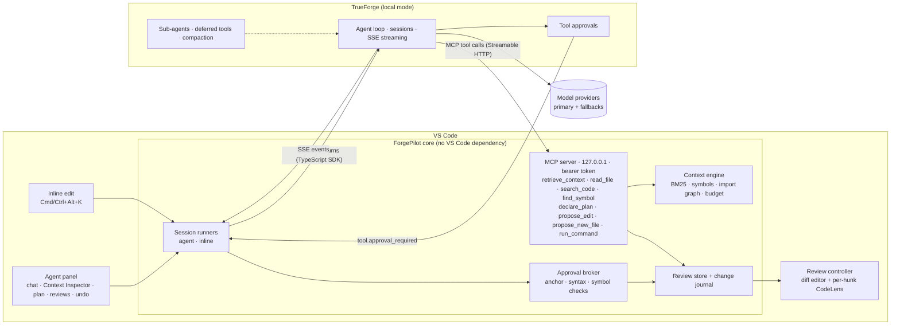
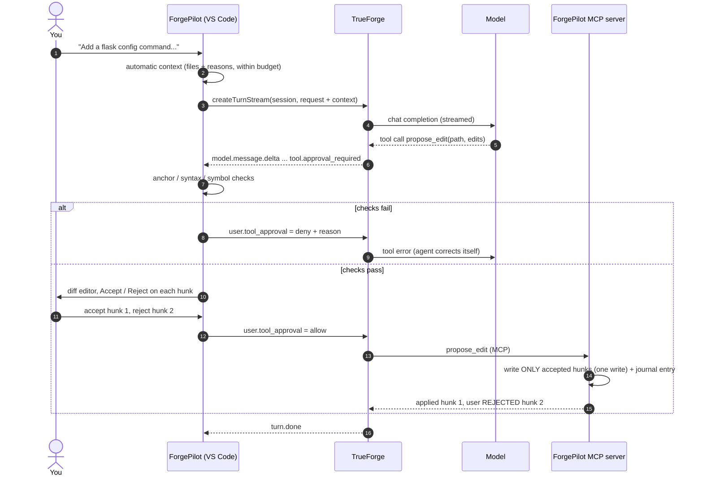
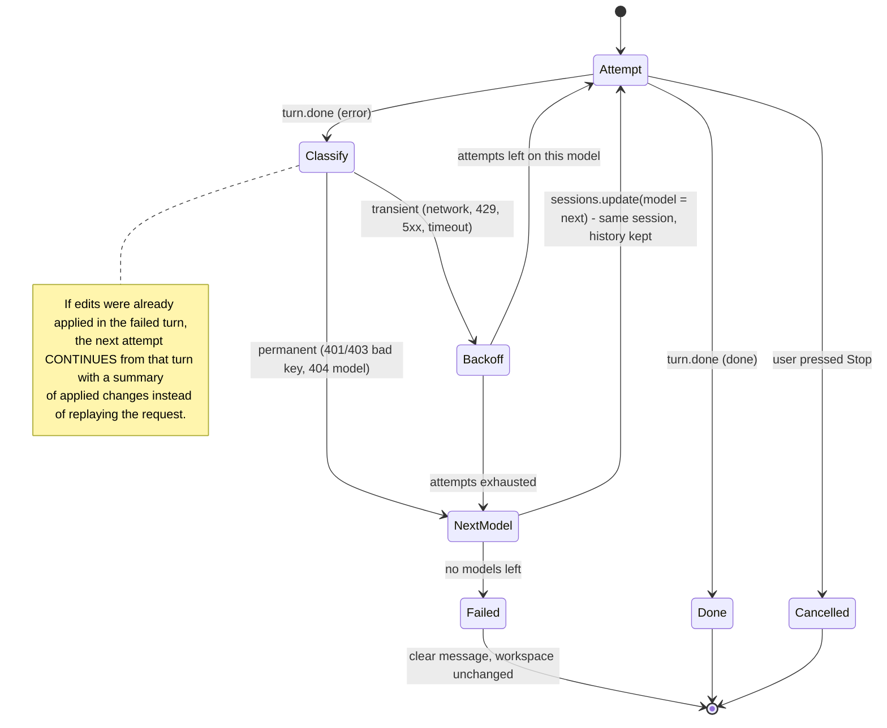
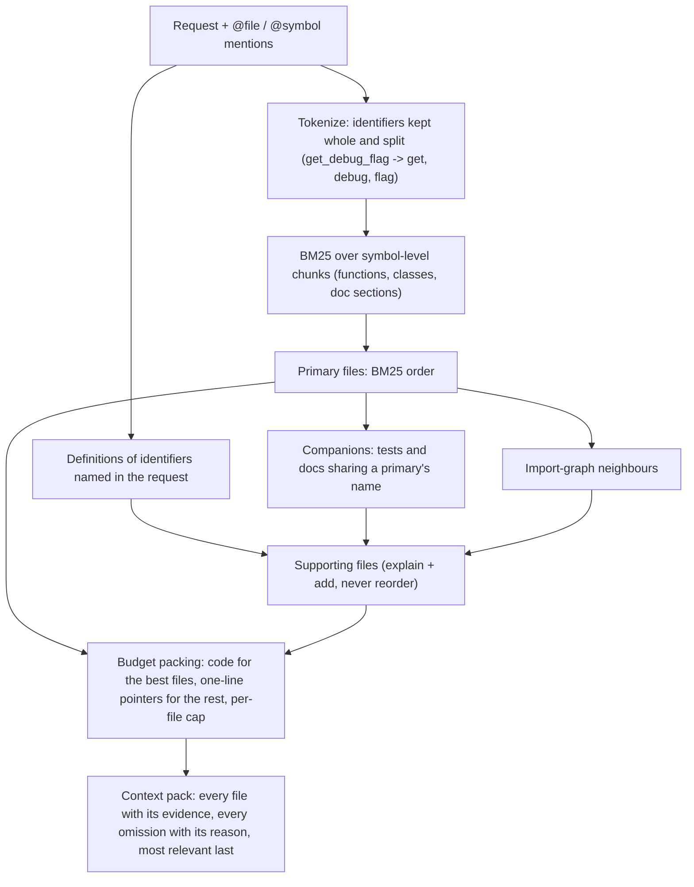

# ForgePilot

**An editor-native coding agent for VS Code whose agent loop runs on [TrueForge](https://github.com/truefoundry/trueforge).**
It finds the right code in repositories larger than any context window and shows you *why* it chose each file. It proposes multi-file changes that you review **hunk by hunk** before anything touches disk. Cancelling never half-applies an edit, and when a model fails it keeps working by switching models on the same TrueForge session.

Built for the TrueFoundry Forge-a-thon (Techfest 2026-27, IIT Bombay). **Starting point: from scratch.** No upstream editor project was forked; the only runtime dependencies are TrueForge's SDK, the MCP SDK, `diff` and `zod`.

---

## Contents

- [What it does](#what-it-does)
- [Guarantees, and the tests that hold us to them](#guarantees-and-the-tests-that-hold-us-to-them)
- [Architecture](#architecture)
- [Install and run](#install-and-run)
- [Using ForgePilot](#using-forgepilot)
- [The three fixed tasks on Flask 3.1.3](#the-three-fixed-tasks-on-flask-313)
- [Models](#models)
- [Testing and evaluation](#testing-and-evaluation)
- [Repository layout](#repository-layout)
- [Known limitations](#known-limitations)
- [License](#license)

---

## What it does

| Capability | How ForgePilot does it |
|---|---|
| **Inline edit** | Select code, press <kbd>Cmd/Ctrl</kbd>+<kbd>Alt</kbd>+<kbd>K</kbd>, describe the change. A tool-less TrueForge agent rewrites only the selection; the result opens in VS Code's diff editor with **Accept / Reject on every hunk**. Hunks outside the selection are flagged, and abbreviated replies (`# ... rest unchanged`) are refused. |
| **Agent mode** | One request in the ForgePilot panel drives a TrueForge tool loop: retrieve context, search, read, declare a plan, propose edits, run tests. It finds the files itself. |
| **Context assembly** | `@file:` / `@symbol:` mentions plus automatic retrieval: BM25 over symbol-level chunks, with symbol definitions, test/doc companions and import-graph neighbours added as supporting evidence. Everything is packed into a **token budget**. The **Context Inspector** shows every file chosen, why, at what token cost, and what was left out. |
| **Diff review** | Each write tool is gated by **TrueForge tool approval**. The approval request becomes a per-hunk review, and only accepted hunks are written. Undo works per change, **per hunk**, or for a whole run, and refuses to overwrite edits you made since. |
| **Streaming and cancellation** | Tokens stream from TrueForge's SSE events. Stop cancels in milliseconds; open reviews are discarded and running commands are killed. Each file write is a single operation, so nothing is half-applied. |
| **Resilience** | TrueForge has no built-in fallback, so ForgePilot classifies failures. Transient ones (network, 429, 5xx) are retried with backoff; permanent ones (bad key, unknown model) are not. It then **switches the same session to the next configured model**, keeping the history. If the failure came after edits were applied, the run continues instead of replaying them. |

### What makes it different

Most coding agents keep you safe by asking you to trust them. ForgePilot checks every edit before you see it:

- **Edits must anchor to text that exists.** Every edit is an exact search/replace against the current file. An edit to code that isn't there is sent back to the agent with the closest matching text, and never reaches you.
- **Hallucinated imports are caught.** If a Python edit imports a name from this repository that does not exist, it is rejected with a "did you mean" hint.
- **Broken syntax never reaches review.** A proposed Python file must parse.
- **Scope is visible.** Hunks outside your selection, or in files the agent did not declare in its plan, carry a warning on the hunk.

---

## Guarantees, and the tests that hold us to them

| Guarantee | Enforced by | Tested in |
|---|---|---|
| Nothing reaches disk without an accepted hunk | MCP write tools refuse any call that has not passed review; approval is per tool call | `test/e2e` (unapproved MCP call refused), `test/vscode` (no write while reviewing) |
| Only accepted hunks are written | hunk engine applies a subset in memory, one write per file | unit tests, 3,000-case fuzz test, `test/e2e`, `test/vscode` |
| Undo never overwrites your later edits | undo re-anchors each hunk by context and refuses if ambiguous; per-run undo is all-or-nothing | unit + fuzz tests |
| Cancel is immediate and consistent | local abort, then `sessions.cancel`; pending reviews discarded; commands killed | `test/e2e` (< 1 s, `git status` clean), `test/vscode` (measured **7 ms**) |
| The editor never blocks | everything async; streaming in the extension host | `test/vscode`: typing latency **12 ms**, event-loop lag **3 ms** while streaming |
| Model failure → fallback, workspace unchanged | retry/backoff, same-session model switch, continuation after partial progress | `test/e2e` (5 scenarios), `test/vscode` (Task C) |

---

## Architecture



The extension is a **client** of TrueForge: it creates sessions, sends turns, renders streamed events and answers approvals. It never calls a model provider. The editor's capabilities are **MCP tools** that TrueForge calls, so the agent decides what to read and change, and ForgePilot decides what is safe to write.

### An agent edit, end to end



### Resilience: retry, then fall back on the same session



### Context pipeline



Why BM25 orders the primaries: an earlier weighted-fusion ranker beat BM25 on the queries we designed it on and **lost on held-out queries** (MRR 0.54 vs 0.78). We kept the evidence and dropped the clever ranking. The full story is in [docs/evaluation.md](docs/evaluation.md).

### TrueForge features used

| Feature | How ForgePilot uses it | Where you see it |
|---|---|---|
| Sessions, turns, SSE streaming | one session per mode (inline and agent never cancel each other) | panel transcript; **Session ↗** opens the TrueForge session inside VS Code |
| Tool approvals | `propose_edit`, `propose_new_file`, `run_command` need approval; approval drives the hunk review | review UI; approvals in the TrueForge session |
| Deferred tool loading | only the tools whose arguments we review are preloaded; `list_files` and `find_symbol` are discovered on demand | TrueForge session (`call_tool`/`list_tools`) |
| Dynamic sub-agents | for multi-file changes the agent first sends one read-only "scout" sub-agent to find where similar features are implemented, registered, tested and documented; ForgePilot **denies any write from a sub-agent thread** | nested "sub-agent" threads in the panel and in the session |
| Compaction | triggers at 40k input tokens on long runs | compaction notices in the panel and session |
| Inline agent specs | sessions use an inline spec so `sessions.update` can switch the model in place (named-agent sessions cannot) | fallback keeps the same session id |

The agent definitions live in [`agents/`](agents): `forgepilot.agent.json` (agent mode) and `inline-edit.agent.json` (tool-less inline edit). ForgePilot loads them at activation and builds the TrueForge `AgentSpec` from them. Neither prompt mentions Flask or the fixed tasks.

---

## Install and run

### Prerequisites

- **Node.js 22.14+** (for TrueForge) and **VS Code 1.95+**
- **git**
- For the Flask tasks: **Python 3.10+**

### 1. Start TrueForge in local mode

ForgePilot's MCP server and any local models run on `127.0.0.1`, which TrueForge blocks by default. Allow it explicitly:

```bash
OUTBOUND_URL_ALLOWED_HOSTS='["localhost","127.0.0.1"]' MODEL_HTTP_MAX_RETRIES=0 npx @truefoundry/trueforge@latest
```

If you use NVIDIA's free API, add its host too:

```bash
OUTBOUND_URL_ALLOWED_HOSTS='["localhost","127.0.0.1","integrate.api.nvidia.com"]' MODEL_HTTP_MAX_RETRIES=0 npx @truefoundry/trueforge@latest
```

This matters on NAT64 networks, which are common on Indian ISPs. There, IPv4-only APIs resolve to `64:ff9b::` addresses, and TrueForge's SSRF guard blocks that range as private.

TrueForge serves its UI and API at <http://localhost:8790>. `MODEL_HTTP_MAX_RETRIES=0` hands retries to ForgePilot, which decides between retry and fallback; it is optional.

### 2. Configure models in TrueForge

Either use the TrueForge UI (**Settings → Model providers**), or:

```bash
cp config/models.example.json config/models.local.json   # git-ignored
# edit config/models.local.json: real keys, "enabled": true on the providers you use
npm run setup:models
```

Any catalog provider or OpenAI-compatible endpoint works (paid API, free tier, gateway, or a local model behind an OpenAI-compatible server). Keys stay inside your local TrueForge.

### 3. Build and install the extension

```bash
git clone https://github.com/rokadepiyush49-rgb/TrueFoundry-Forge-a-thon.git forgepilot
cd forgepilot
npm ci
npm run build
```

Then either:

- **Run from source:** open the folder in VS Code and press <kbd>F5</kbd> ("Run ForgePilot"). A new VS Code window opens with the extension loaded; open your project in it.
- **Install a package:**

  ```bash
  npx @vscode/vsce package --no-dependencies   # produces forgepilot-0.1.0.vsix
  code --install-extension forgepilot-0.1.0.vsix
  ```

### 4. Choose models

Run **ForgePilot: Choose Models** from the command palette and pick the models TrueForge offers, primary first. Or set `forgepilot.models` in your user settings:

```json
"forgepilot.models": ["google-gemini/gemini-3-5-flash-lite", "groq/gpt-oss-120b"]
```

The first is primary; the others are automatic fallbacks.

### Settings

| Setting | Default | Meaning |
|---|---|---|
| `forgepilot.serverUrl` | `http://localhost:8790` | local TrueForge |
| `forgepilot.models` | `[]` | model FQNs in priority order |
| `forgepilot.retry.maxAttempts` | `2` | attempts per model for transient failures |
| `forgepilot.retry.baseDelayMs` | `600` | exponential backoff base |
| `forgepilot.context.budgetTokens` | `6000` | token budget for retrieved code |
| `forgepilot.mcp.port` | `0` | MCP server port (0 = random free port) |

---

## Using ForgePilot

### Agent mode

1. Click the ForgePilot icon in the activity bar.
2. Describe the change. Type `@` to mention a file (`@file:src/app.py`) or a symbol (`@symbol:create_app`).
3. Watch the run as it happens:
   - the **Context · automatic** card: candidate files, the evidence for each, and the token budget;
   - each `retrieve_context` call with its own card;
   - tool calls with their results;
   - the plan;
   - sub-agent threads;
   - retry and fallback notices.
4. When the agent proposes an edit, the diff editor opens. Use **Accept** or **Reject** above each hunk (or the buttons in the panel). Nothing is written until every hunk of that edit has a decision.
5. Use **Session ↗** to see the same run in TrueForge's session viewer: turns, tool calls, approvals and sub-agents.

### Inline edit

Select code → <kbd>Cmd/Ctrl</kbd>+<kbd>Alt</kbd>+<kbd>K</kbd> (or right-click → *ForgePilot: Edit Selection with Instruction*) → type the instruction → review the hunks. A progress notification streams the generation and has a **Cancel** button.

### Undo

- <kbd>Cmd/Ctrl</kbd>+<kbd>Z</kbd> works in the editor (changes are applied as VS Code edits).
- **ForgePilot: Undo Last Applied Change** undoes the most recent file change.
- **ForgePilot: Undo Last Run (all files)** undoes every file a request changed, as one all-or-nothing step.
- The **Applied changes** list in the panel can undo a file, a single hunk (`↶ h2`) or a whole run.

If you have since edited the same lines, ForgePilot refuses instead of overwriting your work.

### Cancel

Press **Stop**, click the spinning status-bar item, or press <kbd>Cmd/Ctrl</kbd>+<kbd>Alt</kbd>+<kbd>Esc</kbd>. Streaming stops at once, open reviews are discarded, and running commands are killed. Hunks you already accepted stay applied and can be undone.

---

## The three fixed tasks on Flask 3.1.3

```bash
git clone https://github.com/pallets/flask.git flask-3.1.3 && cd flask-3.1.3 && git checkout 3.1.3
python3 -m venv ../venv-flask
../venv-flask/bin/pip install -e . "pytest==8.4.2" "python-dotenv==1.2.1" "asgiref==3.11.0"
```

Use `pytest==8.4.2` (the version in Flask's `uv.lock`). Newer pytest removed `_pytest.monkeypatch.notset`, which Flask's `tests/test_cli.py` imports, so `pytest tests/test_cli.py` fails on pristine Flask without the pin.

| Task | What to do | Check |
|---|---|---|
| **A** | open `src/flask/helpers.py`, select `get_debug_flag`, <kbd>Cmd/Ctrl</kbd>+<kbd>Alt</kbd>+<kbd>K</kbd>, paste the instruction, review, accept | `FLASK_DEBUG=off python -c "from flask.helpers import get_debug_flag; print(get_debug_flag())"` → `False` |
| **B** | paste the instruction in the agent panel, no files mentioned; review and accept | `pytest tests/test_cli.py -q`; `flask --app <app> config` |
| **C** | `npm run setup:models -- --broken-primary`, set `forgepilot.models` to `["broken/unreachable", "<a working model>"]` (or only the broken one), repeat Task A | `git status` shows no changes; the panel shows the failure and the automatic fallback |

Independent verifiers check far more than the brief's one-line checks, and are themselves mutation-tested. See [test/verify/README.md](test/verify/README.md):

```bash
PYTHON=../venv-flask/bin/python test/verify/run_all.sh a ../flask-3.1.3
```

---

## Models

ForgePilot works with whatever models TrueForge is configured with; nothing is provider-specific. Inline edit is deliberately tool-less, so it behaves the same on small and local models. The models used during development and their cost are listed in the write-up.

### Run it for free (and what we found)

The brief accepts "a provider's free tier" or "an open-source model running on your own machine", and scores free models exactly like paid ones. `npm run setup:free` registers models in your local TrueForge:

- It asks for each key with hidden input: Gemini, Groq, then optional Anthropic and OpenAI.
- Keys go only to TrueForge, never to disk.
- Each model is checked with a one-line request.

```bash
npm run setup:free
```

What actually worked in our rehearsals (November 2026):

| Model | Tier | Inline edit (A, C) | Agent mode (B) |
|---|---|---|---|
| `groq/gpt-oss-120b` | Groq free | **works** (Task A verifier 10/10 in 3.3 s) | no: Groq rejects the reasoning history TrueForge sends back on the second call, and the free plan allows ~8K tokens/min |
| `google-gemini/gemini-3-5-flash-lite` | Gemini free | — | depends on your Google project; ours returned 403 "free tier not available for this project" |
| `anthropic/claude-haiku-5-5` | paid (cents per run) | not yet rehearsed | planned for Task B; not yet rehearsed |
| local model via Ollama (`http://127.0.0.1:11434/v1`) | free, on the laptop | fine | slow on a 16 GB laptop |

So a free model (Groq) covers Tasks A and C, including Task C's fallback. Task B needs a model that handles multi-turn tool use through TrueForge with larger requests.

Free tiers also rate-limit mid-run, and ForgePilot handles both kinds of limit:

- **Per-minute limits:** it waits out the provider's suggested delay on the **same** model (up to 4 attempts, at most 60 s per wait).
- **Daily quotas:** an exhausted quota falls back at once.

Both behaviours are covered by `test/e2e`. Provider-specific request parameters go in `forgepilot.modelParams`.

### Recording the demo and building the write-up

```bash
# VS Code goes full screen and runs Tasks A, B, C with on-screen verification; ffmpeg records it
FLASK_DIR=../flask-3.1.3 DEMO_VENV=../venv-flask \
DEMO_MODELS_A=groq/gpt-oss-120b DEMO_MODELS_B=anthropic/claude-haiku-5-5 \
DEMO_MODELS_C=broken/unreachable,groq/gpt-oss-120b npm run demo:record

npm run build:writeup   # docs/ForgePilot-Writeup.pdf (fails if over 3 pages)
```

The demo is **scripted**. Every step runs one of ForgePilot's own commands, the same ones the keybindings, CodeLens buttons and panel buttons call. The script only replaces the mouse and keyboard, and pauses so each step is readable. `broken/unreachable` (a closed port) is registered by `npm run setup:models -- --broken-primary`.

---

## Testing and evaluation

| Suite | Command | Needs | Count |
|---|---|---|---|
| Unit + fuzz | `npm test` | nothing | 76 tests, including 3,000 randomized hunk/undo cases |
| End-to-end vs. real TrueForge | `npm run test:e2e` | TrueForge running | 17 scenarios |
| Inside a real VS Code | `npm run test:vscode` | TrueForge running, VS Code installed | 5 scenarios |
| Retrieval evaluation | `npm run eval:retrieval -- ../flask-3.1.3 [--heldout\|--validation]` | Flask checkout | 38 queries |
| Task verifiers + self-test | `test/verify/run_all.sh selftest ../flask-3.1.3` | Flask venv | 13 self-checks |

The end-to-end and VS Code suites use a scripted OpenAI-compatible mock model, so they are deterministic and free. They register a temporary `mock` provider in TrueForge and remove it afterwards.

Bugs these suites found during development, now covered by regression tests:

- **Fuzz test:** two byte-level line-ending bugs (mixed CRLF/LF files).
- **Retrieval evaluation:** an overfit ranker, which was reverted.
- **End-to-end suite:**
  - TrueForge streams tool calls only as deltas, so approvals arrived with no arguments;
  - a fallback after a mid-run failure replayed the request instead of continuing.
- **VS Code suite:** ForgePilot was writing settings into the *workspace* `.vscode/settings.json`, which can show up in `git status`.
- **Verifier self-test:** a verifier check that a test-that-asserts-nothing could pass.

---

## Repository layout

```text
agents/                 TrueForge agent definitions (agent mode, inline edit)
config/                 example model configuration (copy to models.local.json)
docs/                   evaluation notes and the technical write-up
media/                  activity-bar icon and the agent panel (plain HTML/CSS/JS)
scripts/                setup-models.mjs - register providers in TrueForge
src/
  extension.ts          activation, commands, status bar, inline-edit flow
  core/                 everything testable without VS Code
    context/            indexer, symbols, BM25 retrieval, budget packing, symbol checks
    diff/               hunks, search/replace edits, review store, undo journal
    review/             approval broker (TrueForge approvals -> hunk review)
    trueforge/          session runner, agent spec, failure classification
    forgeCore.ts        wires index, MCP server, runners, reviews, journal
  mcp/                  MCP server + editor tools
  vscode/               diff-editor review, agent panel, VS Code file access
test/
  unit/                 unit + fuzz tests
  e2e/                  real TrueForge + mock model
  vscode/               runs inside a real VS Code extension host
  eval/                 retrieval evaluation (dev / held-out / validation)
  verify/               adversarial verifiers for the fixed Flask tasks
```

---

## Known limitations

- Symbol-existence and syntax checks are Python-only. Other languages get anchor checks and review, but no static checks yet.
- Retrieval ranks no better than BM25 (by design, after the held-out result). Gains came from evidence, companions and packing, not ranking.
- `retrieve_context` covers indexed text files up to 400 KB; generated or binary files are skipped.
- Mixed line-ending files are byte-exact in the core engine; VS Code itself may normalize line endings when a document is open.
- TrueForge cancellation waits for in-flight MCP calls; ForgePilot kills its own commands so this is fast, but a slow third-party MCP tool could delay it.

---

## License

MIT. See [LICENSE](LICENSE).
